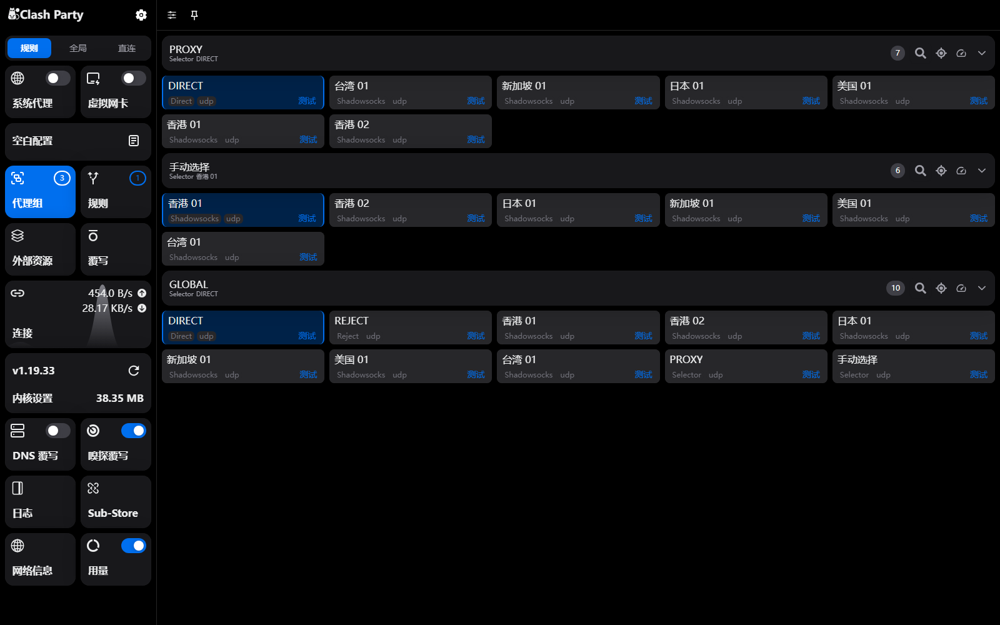
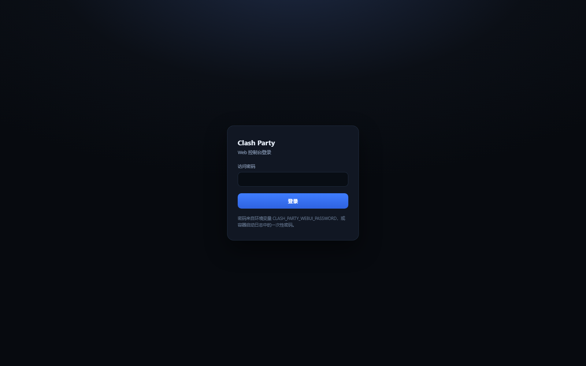
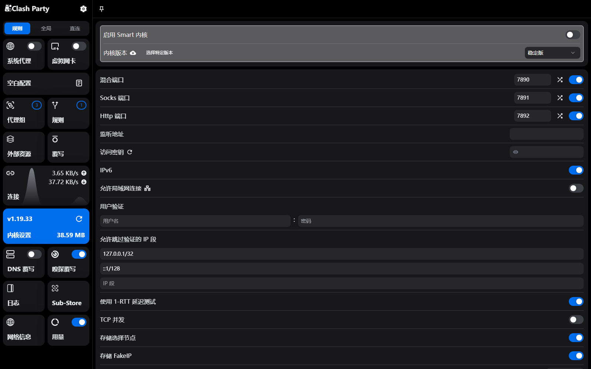
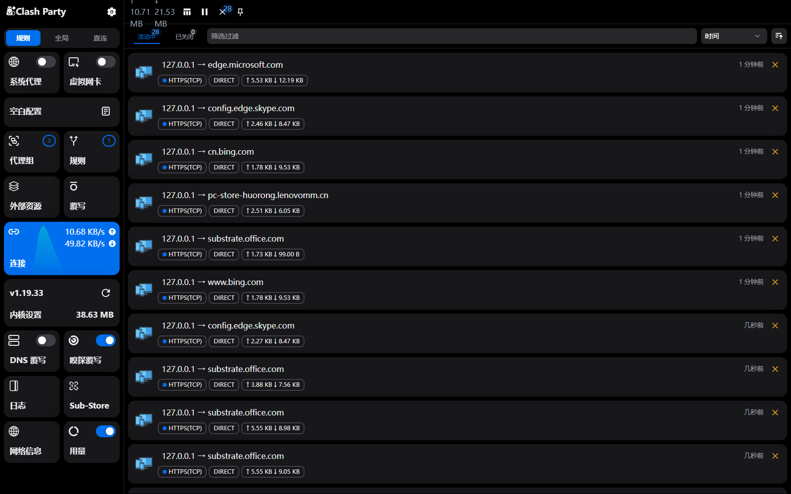
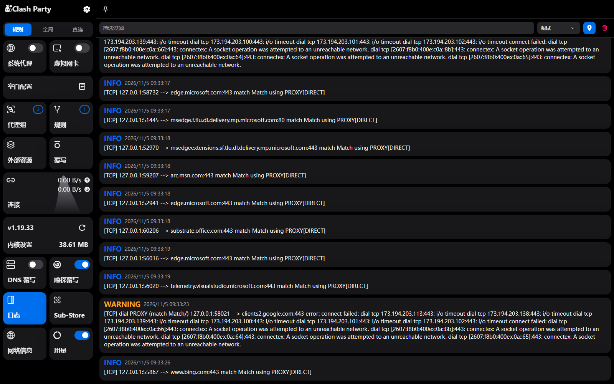

<h3 align="center">
  
  
</h3>

<h3 align="center">Clash Party · 服务化分支</h3>

<p align="center">
同一套 Mihomo GUI，跑在浏览器和容器里。<br>
没有桌面环境、没有图形界面也能用：<code>docker compose up -d</code> → 打开浏览器 → 登录即可。
</p>

<p align="center">
  <a href="https://github.com/HKMV/clash-party-docker/actions/workflows/docker.yml">
    
  </a>
  <a href="https://github.com/HKMV/clash-party-docker/pkgs/container/clash-party-docker">
    
  </a>
  
  
  <a href="https://github.com/mihomo-party-org/clash-party/releases">
    
  </a>
</p>

<p align="center">
  
</p>
<p align="center">
  <sub><b>代理组与节点</b> —— 桌面版的全套界面在浏览器里照常可用，本地节点与分组可视化编辑</sub>
</p>

<p align="center">
  
  
</p>
<p align="center">
  <sub><b>Web 控制台登录</b>（环境变量密码 / HMAC 签名会话） · <b>Smart 内核</b>（<code>mihomo-smart</code> 一键切换）</sub>
</p>

<p align="center">
  
  
</p>
<p align="center">
  <sub><b>实时连接与流量</b>（WebSocket 推送） · <b>实时日志</b>（内核日志流、等级筛选）</sub>
</p>

### 这是什么

本仓库是 [Clash Party](https://github.com/mihomo-party-org/clash-party) 的服务化分支，
默认分支 `smart_core`，当前版本 **2.0.4**。桌面版能力全部保留（Electron 打包链路未改动），
额外提供「同一套界面跑在浏览器 / 容器里」的服务端模式：

| 能力         | 说明                                                                                                                                       |
| ------------ | ------------------------------------------------------------------------------------------------------------------------------------------ |
| 服务端模式   | `src/server` 用纯 Node 复刻 Electron 的 `app` / `ipcMain` / `BrowserWindow`，渲染层通过 `/api/invoke` + `/ws` 与主进程通信，业务代码零改动 |
| 密码登录     | 环境变量指定密码，或启动时自动生成并打印；会话用 HMAC 签名的 Cookie，默认 7 天                                                             |
| 容器镜像     | 多架构（`linux/amd64` / `linux/arm64`），GitHub Actions 自动构建并推送到 GHCR，内核与规则库随镜像打包                                      |
| 数据集中     | 配置、订阅、内核工作目录、流量库全部落在 `/data`，挂载成卷即可迁移                                                                         |
| 桌面链路不变 | Electron 打包、自动更新、TUN 虚拟网卡等桌面能力仍在仓库内，`pnpm build` 照旧产出桌面安装包                                                 |

### 快速开始

```bash
git clone https://github.com/HKMV/clash-party-docker.git
cd clash-party-docker

cp .env.example .env          # 填写 CLASH_PARTY_WEBUI_PASSWORD
mkdir -p data && sudo chown 1000:1000 data   # 容器以 uid 1000 运行

docker compose up -d
docker compose logs -f        # 未设密码时，这里会打印一次性密码
```

打开 `http://<主机>:8080` 登录即可。

不用 compose 的话：

```bash
docker run -d --name clash-party \
  -p 8080:8080 -p 7890:7890 \
  -e CLASH_PARTY_WEBUI_PASSWORD='换成你的密码' \
  -v "$PWD/data:/data" \
  --restart unless-stopped \
  ghcr.io/hkmv/clash-party-docker:latest
```

- 镜像标签：`latest`（默认分支）、`smart_core` / `main`（分支）、`sha-<短哈希>`（单次提交）、`v1.2.3`（标签构建）
- 多架构：`linux/amd64`、`linux/arm64`
- 体积：压缩后约 166 MB（含三个内核、规则库与前端资源），压不动的部分和可选的瘦身手段见 [docs/docker.md](docs/docker.md#镜像体积)
- 端口：`8080` Web UI、`7890` 混合代理、`7891` SOCKS5、`7892` HTTP（后两者需在内核设置里开启）

完整的 compose 用法与示例（固定版本、局域网代理、TUN 网关、反向代理 HTTPS、备份还原、多实例）、
环境变量表、数据卷结构、与桌面版的差异及已知限制，见 **[docs/docker.md](docs/docker.md)**。

仓库内也提供了 [docker-compose.yml](docker-compose.yml)、[.env.example](.env.example) 与 [Dockerfile](Dockerfile)，
可自行 `docker build` 或 `docker compose up -d`。

### 本分支特性

- [x] 浏览器可用的完整界面：代理、订阅、规则、连接、日志、流量、DNS、域名嗅探、覆写、Sub-Store 与桌面版一致
- [x] 本地配置：可视化编辑订阅、代理组、规则、规则集、DNS 与域名嗅探，支持本地节点管理与节点链接导入（SS / SSR / VMess / VLESS / Trojan / Hysteria2 / TUIC / WireGuard / Tailscale / SSH / SOCKS5 / Snell 等）
- [x] Smart 内核：内置 `mihomo-smart`，支持 Smart 选路模型与自动 Smart 规则覆写
- [x] 连接详情可直接生成规则，切换节点时可只关闭当前代理组的连接
- [x] DNS 覆写保护开关、日志等级筛选、侧边栏折叠后悬停展开
- [x] 一键 Smart Core 规则覆写，基于 AI 模型自动选择最优节点，详细介绍见 [Smart Core](https://clashparty.org/docs/guide/smart-core)

### 上游同步

上游 [mihomo-party-org/clash-party](https://github.com/mihomo-party-org/clash-party) 的 `smart_core`
每天由 [Sync Upstream](.github/workflows/sync-upstream.yml) 自动合并进来：

- **没有冲突** → 先跑 `format:check` / `lint:check` / `typecheck`，通过后推 `smart_core`，
  由 docker.yml 的 push 触发自动构建并发布镜像
- **有冲突** → 合并结果推到 `sync/upstream` 分支并开一条草稿 PR，主干和镜像都不动，人工解决后再合并
- 本分支独有的文件（Dockerfile、compose、服务端代码等）列在
  [.github/sync/keep-local.txt](.github/sync/keep-local.txt)，冲突时直接保留本地版本

推送用 `SYNC_TOKEN`（带 `workflow` 权限的 PAT）：上游提交经常改动 `.github/workflows/*`，
而 `GITHUB_TOKEN` 没有 workflows 权限，push 会被 GitHub 直接拒绝。

手动触发、本地预演与冲突处理流程见 [docs/docker.md](docs/docker.md#上游同步与镜像发布)。

### 特性

- [x] 开箱即用，无需服务模式的 Tun
- [x] 多种配色主题可选，UI 焕然一新
- [x] 支持大部分 Mihomo(Clash Meta) 常用配置修改
- [x] 内置 Smart内核 与 Mihomo(Clash Meta) 内核
- [x] 通过 WebDAV 一键备份和恢复配置
- [x] 强大的覆写功能，任意修订配置文件
- [x] 深度集成 Sub-Store，轻松管理订阅

### 安装/使用指南见 [官方文档](https://clashparty.org)
